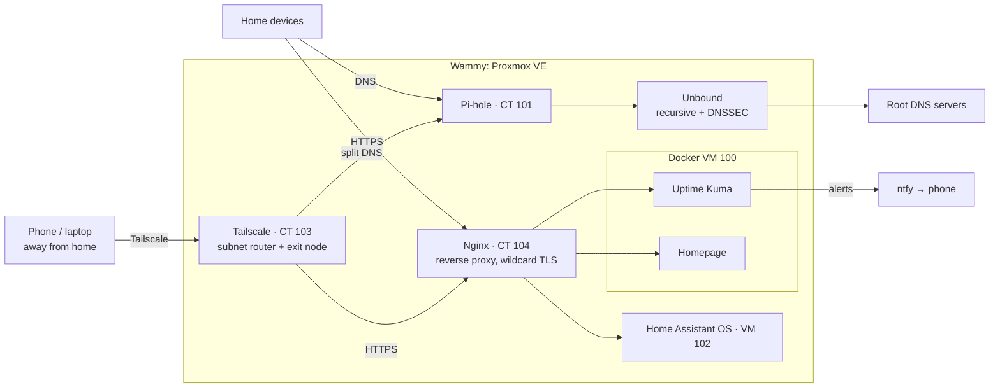
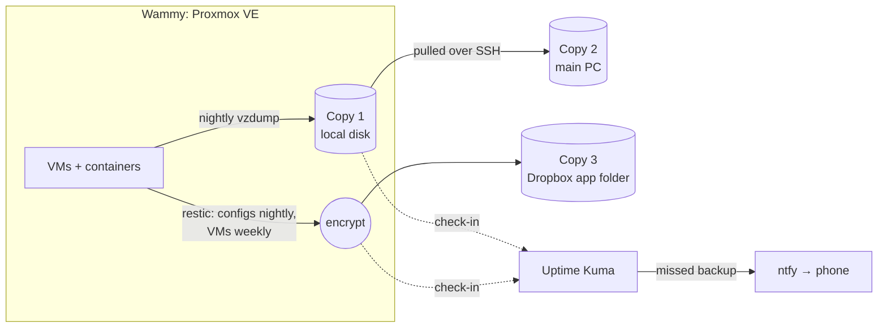

# Wammy Homelab

A self-hosted homelab built on Proxmox, used to learn networking, Linux, automation and security alongside a Cybersecurity & Digital Forensics degree.

> **Status:** Phases 0, 1 , 2 and 3 complete. Phase 4 in progress.

## What it is

| Machine | Role |
|---|---|
| **Wammy** (Dell OptiPlex 3080, i5, 2TB NVMe) | Proxmox host running the network services, everyday apps and security tools |
| **Main desktop** (RTX 3060 Ti) | Runs Ollama for local AI |
| **Arch laptop** | Planned privileged access workstation (Phase 8): the only machine allowed to administer Wammy |

### Network and services



### Backups (3-2-1)



## Roadmap

| Phase | Focus | Status | Write-up |
|---|---|---|---|
| 0 | Secure baseline: SSH keys, updates, Proxmox 2FA | 🟢 Done | [Phase 0](docs/phases/phase-0-baseline.md) |
| 1 | Pi-hole + Unbound in their own LXC | 🟢 Done | [Phase 1](docs/phases/phase-1-pihole.md) |
| 2 | Backups: 3-2-1 with encrypted offsite, tested restores, push alerts | 🟢 Done | [Phase 2](docs/phases/phase-2-backups.md) |
| 3 | Home Assistant OS VM, first devices and automation | 🟢 Done | [Phase 3](docs/phases/phase-3-home-assistant.md) |
| 4 | Platform: Tailscale, Nginx, Homepage, Uptime Kuma, Forgejo | 🟡 In progress | [Part 1: Tailscale](docs/phases/phase-4-tailscale.md) · [Part 2: Domain & reverse proxy](docs/phases/phase-4-reverse-proxy.md) |
| 5 | Everyday services: Vaultwarden, Paperless-ngx, Mealie, Syncthing, Jellyfin, fitness | ⚪ Planned | |
| 6 | My own Python services: network watcher, budget app | ⚪ Planned | |
| 7 | AI layer: Ollama, voice, RAG "life admin brain" | ⚪ Planned | |
| 8 | Security and hardening: PAW, Wazuh, CrowdSec, Grafana, isolated attack lab | ⚪ Planned | |

Status key: ⚪ Planned · 🟡 In progress · 🟢 Done

## Repo layout

```
docs/
  phases/          one write-up per phase: what I did, what broke, what I learned
  decisions.md     design decisions and why I made them
  inventory.md     services, where they run, ports (sanitised)
  posting-checklist.md  what to check before anything goes public
services/
  _template/       copy this to start a new service
  <service>/       config files, compose.yml, .env.example, README.md per service
diagrams/          architecture and network diagrams
```

## Security practices

- No services are exposed to the internet (verified with an external port scan). Remote access goes through Tailscale with an exit node; no open ports.
- Key-only SSH with password login disabled on every host. Administration will be restricted to a dedicated PAW (Phase 8).
- 2FA on the Proxmox and Home Assistant web interfaces.
- Secrets live in `.env` files, which are git-ignored. Only `.env.example` files with placeholder values are committed.
- Every commit is scanned for secrets with [gitleaks](https://github.com/gitleaks/gitleaks) via a pre-commit hook.
- Public IPs, internal IP addresses, domains, Wi-Fi names and device lists are never published.

## Licence

MIT. See [LICENSE](LICENSE).
